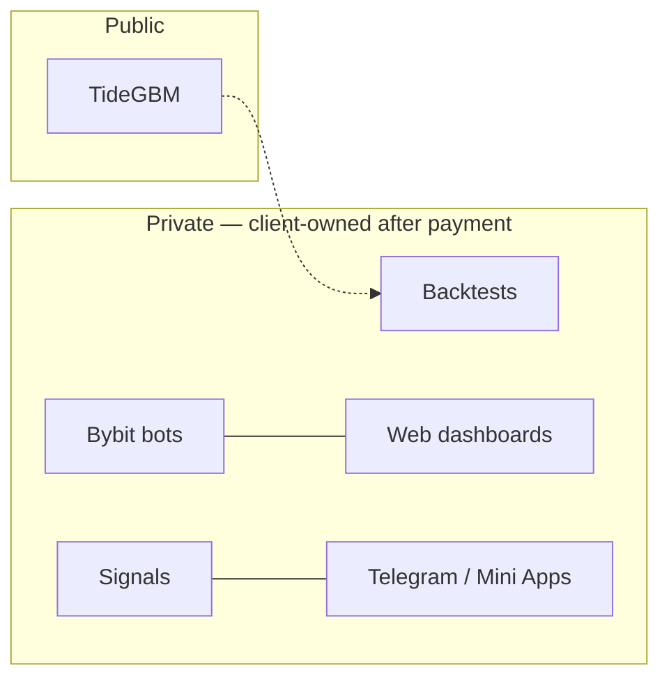

<div align="center">

# Vizanix Team

**Trading software for Bybit and crypto markets**

Bots · signals · backtests · operator web apps

[](https://vizanix.tech)
[](https://t.me/vizanix)
[](https://t.me/vizanix_team)
[](https://pypi.org/project/tidegbm/)
[](https://www.python.org/)

[vizanix.tech](https://vizanix.tech) · [@vx_ceo](https://t.me/vx_ceo) · [t.me/vizanix](https://t.me/vizanix) · [t.me/vizanix_team](https://t.me/vizanix_team)

</div>

---

## About

Development team. We ship **custom trading software**: Bybit V5 execution, signal systems, honest backtests, and the dashboards operators actually sit in. Same people build APIs, sites, Telegram bots and Mini Apps when the product needs a control surface.

We do not custody funds, run a prop desk, or sell “guaranteed profit” signals. We write software that executes **your** rules — reconnect logic, rate limits, monitoring, **testnet first**, source handover after payment.

The full catalog and contact path live on **[vizanix.tech](https://vizanix.tech)**. What you see here is the engineering surface: libraries and demos. Client systems stay private.

---

## Featured

### [TideGBM](https://github.com/Vizanix-Team/TideGBM) — temporal ordered gradient boosting

[](https://github.com/Vizanix-Team/TideGBM/actions/workflows/ci.yml)
[](https://pypi.org/project/tidegbm/)
[](https://pypi.org/project/tidegbm/)
[](https://github.com/Vizanix-Team/TideGBM/blob/main/LICENSE)
[](https://github.com/Vizanix-Team/TideGBM)

Histogram GBDT for **time-indexed and cross-sectional panel** tables — the shape of market and multi-entity data. C++17 engine, sklearn-style Python API, optional CUDA histograms.

Not another “alpha bot.” You bring `X` and `y`. TideGBM treats **time order**, **entity structure**, and **purged evaluation** as first-class: TORB residuals, leak lint that refuses lookahead features, pairwise ranking for cross-sectional IC.

```python
from tidegbm import TideRegressor

model = TideRegressor(horizon=1, n_estimators=200, max_depth=6, objective="pairwise")
model.fit(X_train, y_train, timestamp="ts", entity="symbol")
pred = model.predict(X_live)
```

```bash
pip install tidegbm
```

Public stand (purged walk-forward, 30 liquid names): pairwise TideGBM mean IC **0.031** vs LightGBM **0.019** on that protocol — a sanity check, not a profit claim. Writeup: [docs/TIDEBENCH.md](https://github.com/Vizanix-Team/TideGBM/blob/main/docs/TIDEBENCH.md).

---

## What we ship for clients

Public repos are kits. Production bots, panels, and strategies stay in private repos and transfer to you after payment.

| | |
|---|---|
| **Bybit trading bots** | V5 REST + WebSocket · spot / linear / inverse · SL / TP / trailing · paper then live |
| **Signals & screeners** | Alerts, ranking, operator workflows — your rules, not a hosted signal feed |
| **Backtesting** | Purged / walk-forward, fees, funding, realistic fills — same honesty as TideGBM |
| **Web apps** | React / Vite dashboards, FastAPI / Django, realtime PnL and order control |
| **Telegram** | Ops bots, alerts, Mini Apps as a control surface |

---

## Stack

```bash
vizanix@ship:~$ env | grep STACK
```

```ini
LANGUAGES   = Python · C++ · TypeScript · JavaScript
BACKEND     = FastAPI · Django · PostgreSQL · Redis · WebSockets · Docker
FRONTEND    = React · Vite · Next.js
TRADING     = Bybit V5 REST · Bybit V5 WebSocket · backtests · paper trading
TELEGRAM    = Bot API · Mini Apps
QUANT       = TideGBM · time-series / panel · leak-safe CV
```

---

## How the work clusters



---

## Recently shipped

- **[TideGBM](https://github.com/Vizanix-Team/TideGBM)** [`v0.4.0`](https://pypi.org/project/tidegbm/) — C++ histogram GBDT, PyPI, CI, purged-benchmark protocol

Next public kits (libraries and demos, not live strategies): a typed **Bybit V5** client and a **purged backtest** harness.

---

## Русский

Команда разработчиков: торговые и сигнальные боты для **Bybit**, бэктест стратегий, веб-панели оператора. Дальше по стеку — API, сайты, Telegram-боты и Mini Apps.

Не храним средства, не торгуем «за вас», не продаём сигналы с обещанием прибыли. Пишем софт под ваши правила, сначала testnet, исходный код после оплаты.

Открытый код — это библиотеки вроде [TideGBM](https://github.com/Vizanix-Team/TideGBM). Боевые системы клиентов на GitHub не выкладываем.

**[vizanix.tech](https://vizanix.tech)** · Telegram [vizanix](https://t.me/vizanix) · [@vx_ceo](https://t.me/vx_ceo)
